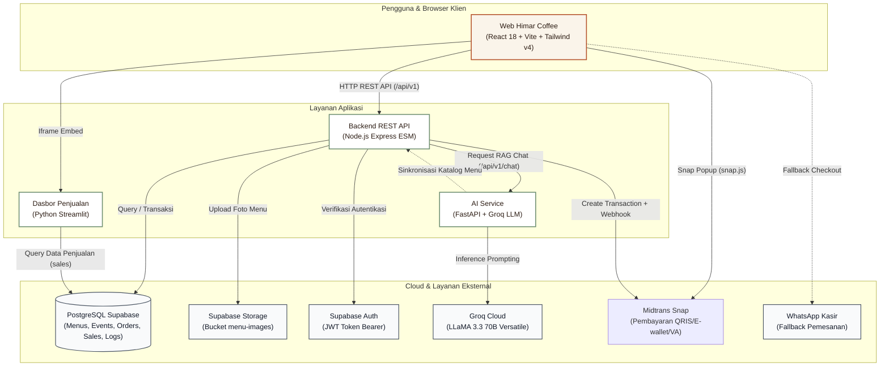
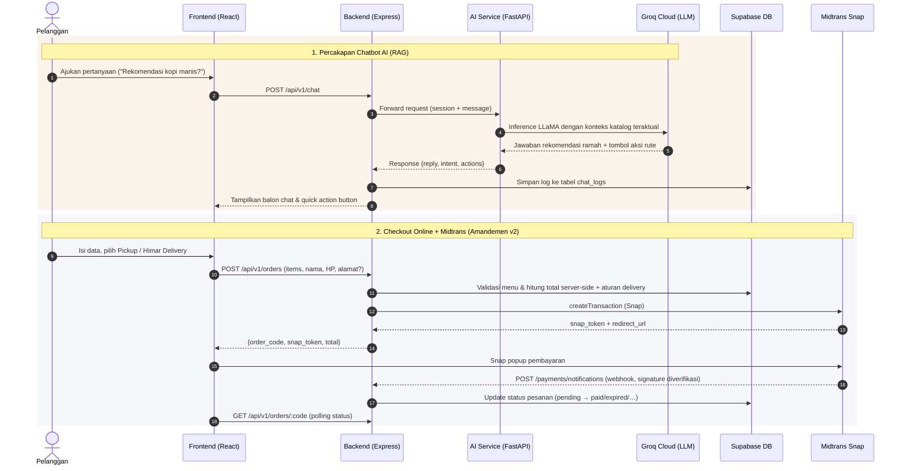

# Himar Coffee Garut — Platform Digital Full-Stack UMKM

Platform etalase digital modern, asisten chatbot AI cerdas, dan dasbor analitik penjualan untuk kedai kopi lokal **Himar Coffee Garut** (Tarogong Kidul, Garut, Jawa Barat).

---

## 1. Latar Belakang & Masalah UMKM

### Masalah yang Dihadapi Kedai Kopi Lokal:
1. **Pemesanan Manual yang Rentan Kesalahan:** Pelanggan sering memesan lewat chat WhatsApp tanpa format jelas, menyebabkan salah hitung harga atau varian minuman yang keliru dicatat barista.
2. **Katalog Tidak Dinamis:** Penggunaan buku menu cetak atau feed Instagram menyulitkan pembaharuan menu saat stok biji kopi/bahan habis mendadak atau saat peluncuran menu musiman baru.
3. **Barista Kewalahan Menjawab Pertanyaan Berulang:** Pertanyaan pelanggan seputar menu rekomendasi, daftar harga, jadwal event live acoustic, hingga rute kedai sering kali menyita waktu barista yang sedang meracik kopi.
4. **Ketiadaan Visibilitas Performa Penjualan:** Data transaksi belum terekam rapi dalam grafik tren yang mudah dipahami pemilik kedai untuk perencanaan stok dan strategi promosi.

### Solusi yang Diberikan:
- **Katalog Menu Digital Responsif:** Pelanggan dapat menjelajahi menu, mencari minuman, melihat pilihan varian (*Hot/Iced*), dan memeriksa ketersediaan secara *real-time*.
- **Checkout Online + Pembayaran Midtrans:** Format pesanan tervalidasi dengan kalkulasi harga server-side, pembayaran aman via Midtrans Snap (QRIS, e-wallet, virtual account, kartu), dan status pesanan *real-time* — tanpa perlu chat WhatsApp. *(Amandemen v2)*
- **Himar Delivery:** Pilihan ambil di kedai (*pickup*) atau delivery dengan ongkir flat, minimum order nominal, dan menu **signature dihitung ganda** untuk memenuhi minimum. *(Amandemen v2)*
- **Asisten AI Terintegrasi (Groq LLM + RAG):** Chatbot cerdas yang siap menjawab pertanyaan pelanggan 24/7 seputar menu, jadwal event, dan panduan order dengan tombol aksi cepat.
- **Portal Admin Mandiri:** Antarmuka pengelola untuk menambah/mengedit/menghapus menu, mengunggah foto, mengatur jadwal event, dan membaca log percakapan.
- **Dasbor Penjualan Interaktif (Streamlit):** Visualisasi tren pendapatan harian, menu terlaris (*best seller*), dan komposisi kategori penjualan.

---

## 2. Fitur Utama

- **Katalog Menu & Filter:** Pencarian debounced, filter kategori instan, modal detail menu dengan pilihan varian dan penyesuaian harga dinamis.
- **Agenda Event Komunitas:** Tab event mendatang dan arsip kegiatan yang telah usai (*live acoustic*, *workshop latte art*, dll).
- **Checkout Online & Pembayaran Midtrans Snap (Amandemen v2):** Halaman `/checkout` dengan data pemesan, pilihan pickup/delivery, ringkasan biaya, pembayaran via Snap popup (QRIS/e-wallet/VA/kartu), dan halaman status `/order/:code` dengan polling otomatis. Status *paid* hanya ditetapkan lewat webhook Midtrans yang terverifikasi signature.
- **Himar Delivery (Amandemen v2):** Ongkir flat, minimum order nominal (default Rp30.000), menu signature dihitung ganda untuk minimum, badge & urutan prioritas signature di keranjang/checkout. Fallback pesan via WhatsApp tetap tersedia.
- **Chatbot Asisten Berbasis AI:** Menggunakan model Groq `llama-3.3-70b-versatile` dengan konteks katalog teraktual (RAG) dan fallback intent classifier deterministik bila offline.
- **Portal Manajemen Admin:**
  - Autentikasi aman berbasis Bearer JWT Supabase.
  - CRUD menu lengkap dengan integrasi upload gambar ke Supabase Storage (`menu-images`).
  - CRUD event dengan pengaturan publikasi (*draft* / *terbit*).
  - Tampilan iframe Dasbor Analitik Penjualan.
  - Pemantauan log percakapan chatbot pengguna.
- **Desain Khusus Coffee Shop (WCAG AA Compliant):**
  - Palet warna hangat: Terracotta (`#B5532C`), Espresso (`#2B1B12`), Cream (`#FAF4EA`), dan Sage (`#6F8F72`).
  - Tipografi elegan: Serif *Fraunces* untuk judul dan Sans *Inter* untuk keterbacaan teks.

---

## 3. Arsitektur Sistem



### Alur Kerja Sistem (Sequence Diagram)



---

## 4. Struktur Repositori

```
web-himar/
├── frontend/                  # Aplikasi Web Publik & Portal Admin (React Vite Tailwind v4)
│   ├── src/
│   │   ├── api/               # Axios client terpusat & error normalizer
│   │   ├── components/        # Navbar, Footer, Layout, Skeletons, EmptyState
│   │   ├── features/          # CartContext, CartDrawer, ChatWidget, AdminLayout, AuthProvider
│   │   └── pages/             # Home, Menu, Events, Admin (Menus, Events, Dashboard, Logs)
│   └── vercel.json            # Konfigurasi SPA rewrite routing
├── backend/                   # Backend REST API (Node.js Express ESM)
│   ├── src/
│   │   ├── config/            # Env validation (Joi), Supabase Admin & Auth client
│   │   ├── controllers/       # Menu, Event, Auth, Order, Chat, Admin controllers
│   │   ├── middleware/        # Error handler, Rate limiters, Joi validator, RequireAdmin
│   │   ├── routes/            # /menus, /events, /auth, /admin, /orders, /chat
│   │   └── services/          # WhatsApp calculation, Log service, AI client, AI mock
│   ├── scripts/               # seed.js (menus & events), seed_sales.js (sales data)
│   ├── tests/                 # Vitest integration test suite (25 test cases)
│   └── vercel.json            # Serverless deployment configuration
├── ai-service/                # Microservice AI Chatbot (FastAPI + Groq LLM)
│   ├── src/
│   │   ├── config.py          # Konfigurasi env & API keys
│   │   ├── catalog.py         # Catalog retrieval & RAG context builder
│   │   ├── llm.py             # Prompting Groq & Fallback keyword classifier
│   │   └── main.py            # FastAPI endpoints (/health, /api/v1/chat, /api/v1/reindex)
│   ├── requirements.txt
│   └── vercel.json
├── dashboard/                 # Dasbor BI & Analitik Penjualan (Streamlit)
│   ├── app.py                 # Visualisasi Streamlit & koneksi database
│   └── requirements.txt
├── docs/                      # Dokumentasi Teknis
│   ├── api-contract.md        # Spesifikasi detail seluruh endpoint API
│   ├── schema.sql             # Skema DDL tabel database Supabase
│   ├── user-manual.md         # Buku panduan pengguna (pelanggan & pengelola)
│   ├── test-report.md         # Laporan pengujian otomatis & manual
│   └── api.http               # Koleksi contoh HTTP request untuk pengujian
├── render.yaml                # Spesifikasi deployment web service Render
└── README.md
```

---

## 5. Prasyarat & Variabel Lingkungan (Environment Variables)

### Kebutuhan Sistem:
- **Node.js** v20 atau lebih baru
- **Python** 3.10 atau lebih baru
- Akun **Supabase** (dengan database & storage bucket `menu-images`)
- Akun **Groq Cloud** (untuk API Key LLM)

### Tabel Variabel Lingkungan:

#### Backend (`backend/.env`):
| Variabel | Deskripsi | Nilai Contoh |
|----------|-----------|--------------|
| `PORT` | Port server lokal | `4000` |
| `NODE_ENV` | Mode aplikasi | `development` / `production` / `test` |
| `SUPABASE_URL` | URL project Supabase | `https://xxxx.supabase.co` |
| `SUPABASE_PUBLISHABLE_KEY` | Anon / Publishable key Supabase | `sb_publishable_...` |
| `SUPABASE_SECRET_KEY` | Service Role / Secret key Supabase | `sb_secret_...` |
| `FRONTEND_URL` | URL frontend yang diizinkan CORS | `http://localhost:5173,http://localhost:3000` |
| `ADMIN_EMAILS` | Daftar email berhak akses admin | `himar@admin.com` |
| `WHATSAPP_NUMBER` | Nomor WhatsApp kedai | `62895620019593` |
| `AI_MOCK` | Gunakan AI mock tanpa memanggil ai-service | `false` (atau `true` untuk offline) |
| `AI_SERVICE_URL` | URL ai-service FastAPI | `http://localhost:8000` |
| `INTERNAL_API_KEY` | Kunci rahasia komunikasi antar-layanan | `himar_internal_2024_secret_key` |
| `AI_TIMEOUT_MS` | Batas waktu request ke AI (ms) | `20000` |
| `MIDTRANS_SERVER_KEY` | Server Key Midtrans (prefix `SB-Mid-server-` untuk sandbox) | `SB-Mid-server-...` |
| `MIDTRANS_CLIENT_KEY` | Client Key Midtrans (prefix `SB-Mid-client-` untuk sandbox) | `SB-Mid-client-...` |
| `MIDTRANS_IS_PRODUCTION` | `false` = sandbox Midtrans, `true` = production | `false` |
| `DELIVERY_FEE` | Ongkir flat Himar Delivery (Rupiah) | `8000` |
| `DELIVERY_MIN_ORDER` | Minimum subtotal untuk Himar Delivery (Rupiah) | `30000` |

#### Frontend (`frontend/.env`):
| Variabel | Deskripsi | Nilai Contoh |
|----------|-----------|--------------|
| `VITE_API_BASE_URL` | Base URL API backend | `http://localhost:4000/api/v1` |
| `VITE_DASHBOARD_URL` | URL publik Dasbor Streamlit | `https://himar-coffee.streamlit.app` |
| `VITE_MIDTRANS_CLIENT_KEY` | Client Key Midtrans untuk popup Snap | `SB-Mid-client-...` |

#### AI Service (`ai-service/.env`):
| Variabel | Deskripsi | Nilai Contoh |
|----------|-----------|--------------|
| `PORT` | Port service AI | `8000` |
| `GROQ_API_KEY` | API Key dari Groq Cloud | `gsk_...` |
| `INTERNAL_API_KEY` | Kunci internal sinkronisasi | `himar_internal_2024_secret_key` |
| `BACKEND_URL` | URL backend untuk fetch katalog | `http://localhost:4000` |

#### Dasbor (`dashboard/.env`):
| Variabel | Deskripsi | Nilai Contoh |
|----------|-----------|--------------|
| `SUPABASE_URL` | URL project Supabase | `https://xxxx.supabase.co` |
| `SUPABASE_KEY` | Secret Key Supabase | `sb_secret_...` |

---

## 6. Cara Menjalankan di Komputer Lokal

### 1. Inisialisasi Database & Seeding
Pastikan skema tabel di `docs/schema.sql` telah dieksekusi di SQL Editor Supabase dan bucket storage `menu-images` diset *public*.

```bash
# Masuk ke direktori backend
cd backend
npm install

# 1) (Opsional) Perbaiki foto beresolusi rendah jadi lebih tajam.
#    Butuh Real-ESRGAN atau ImageMagick. Melembutkan foto 67-237 px agar
#    tidak burem saat tampil di kartu menu.
npm run photos:upscale

# 2) Ubah "Dataset Himar Coffee.xlsx" menjadi snapshot JSON (menu, event,
#    transaksi). Path Excel bisa diberikan sebagai argumen.
npm run data:generate -- "/path/Dataset Himar Coffee.xlsx"

# 3) Unggah foto produk ke Supabase Storage (butuh koneksi internet)
#    Sumber foto: folder product-photos/ di root repo (tidak ikut Git).
#    Foto dikonversi ke WebP (~12 KB/foto) lalu diunggah ke bucket menu-images.
#    Hasil mapping URL disimpan di scripts/image-map.json.
npm run upload:images

# 4) Import penuh dataset ke Supabase: 74 menu, 11 kategori, 5 event,
#    dan 5.792 transaksi penjualan.
#    ⚠️  Script ini MENGHAPUS isi tabel menus, events, dan sales lebih dulu.
npm run data:import -- --yes

# Bila foto diganti, naikkan versi agar cache CDN/browser tidak menyajikan
# gambar lama, lalu paksa URL di database ikut diperbarui:
#   IMAGE_VERSION=3 npm run upload:images
#   FORCE_IMAGES=1 npm run seed

# Alternatif: seed 74 menu dataset tanpa menghapus (idempoten) + event
npm run seed

# Alternatif tanpa foto/Supabase Storage: seed data dummy lama
npm run seed:dummy
```

> ℹ️ **Sumber data:** harga, deskripsi, varian, kategori, event, dan riwayat
> penjualan diambil dari `Dataset Himar Coffee.xlsx` (lembar `Produk`,
> `Varian_Harga`, `Kategori`, `Event`, `Transaksi`). Dua lembar tidak
> diimpor karena tidak ada tabelnya di skema: `Stok_Produk` dan `Riwayat_Stok`
> (stok) serta `Admin` (akun admin dibuat lewat Supabase Auth).

### 2. Menjalankan Backend Express
```bash
cd backend
npm run dev
# Server berjalan di http://localhost:4000
# Endpoint cek kesehatan: http://localhost:4000/api/v1/health
```

### 3. Menjalankan AI Service FastAPI
```bash
cd ai-service
python -m venv venv
# Windows:
venv\Scripts\activate
# Linux/macOS:
# source venv/bin/activate

pip install -r requirements.txt
uvicorn src.main:app --reload --port 8000
# Service AI aktif di http://localhost:8000
```

### 4. Menjalankan Frontend React
```bash
cd frontend
npm install
npm run dev
# Aplikasi terbuka di http://localhost:5173
```

### 5. Menjalankan Dasbor Streamlit
```bash
cd dashboard
pip install -r requirements.txt
streamlit run app.py
# Dasbor aktif di http://localhost:8501
```

---

## 7. Menjalankan Pengujian Otomatis

Pengujian backend mencakup 25 skenario integrasi menyeluruh (*public endpoints, auth guard, validasi, otorisasi admin, orders calculation, chat mock, dan error handler*):

```bash
cd backend
npm test
```

Untuk menguji build produksi frontend:
```bash
cd frontend
npm run build
```

---

## 8. Panduan Deployment

### 1. Backend (Render / Vercel):
- **Opsi Render:** Menggunakan file `render.yaml` yang disertakan di repositori.
  1. Buat **New Web Service** dari repositori GitHub.
  2. Pilih direktori root `backend`.
  3. Konfigurasikan variabel lingkungan sesuai tabel di atas.
  4. Health check path: `/api/v1/health`.
- **Opsi Vercel:** Deploy folder `backend` menggunakan preset Node.js Serverless via `backend/vercel.json`.

### 2. Frontend (Vercel):
1. Buka dasbor [Vercel](https://vercel.com) dan impor repositori.
2. Atur **Root Directory** ke `frontend`.
3. Framework Preset: **Vite**.
4. Masukkan Environment Variables:
   - `VITE_API_BASE_URL` = URL backend produksi (misal: `https://himar-backend.onrender.com/api/v1`)
   - `VITE_DASHBOARD_URL` = URL dasbor Streamlit publik.
5. Deploy. `frontend/vercel.json` secara otomatis mengarahkan seluruh routing SPA ke `index.html`.

### 3. Dasbor Penjualan (Streamlit Community Cloud):
1. Masuk ke [share.streamlit.io](https://share.streamlit.io/).
2. Hubungkan repositori GitHub, arahkan file utama ke `dashboard/app.py`.
3. Buka **Advanced Settings > Secrets** dan masukkan:
   ```toml
   SUPABASE_URL = "https://xxxx.supabase.co"
   SUPABASE_KEY = "sb_secret_..."
   ```
4. Salin URL aplikasi Streamlit yang dihasilkan dan masukkan ke `VITE_DASHBOARD_URL` pada frontend.

---

## 9. Sumber Pustaka & API yang Digunakan

| Komponen | Pustaka / Layanan | Kegunaan |
|----------|-------------------|----------|
| **Database & Auth** | [Supabase](https://supabase.com/) | Postgres Database, Autentikasi Pengguna, dan Cloud Object Storage |
| **LLM Model** | [Groq Cloud](https://groq.com/) | Model `llama-3.3-70b-versatile` dengan inferensi berkecepatan tinggi |
| **Backend Core** | Express, Helmet, CORS, Morgan | HTTP Server, Keamanan Header, dan Middleware Logging |
| **Validasi Skema** | Joi | Validasi input ketat di setiap rute backend |
| **Rate Limiter** | express-rate-limit | Proteksi DoS dan pembatasan request spam |
| **Frontend Framework** | React 18 + Vite | Single Page Application (SPA) reaktif dan cepat |
| **Styling** | Tailwind CSS v4, Lucide Icons | Desain antarmuka, tata letak responsif, dan ikon modern |
| **Dasbor BI** | Streamlit, Plotly, Pandas | Visualisasi data dan grafik analitik interaktif |
| **Testing** | Vitest + Supertest | Framework pengujian unit dan integrasi otomatis |

---

## 10. Keputusan Desain & Batasan Sistem

### Keputusan Desain:
1. **Harga Tidak Pernah Dipercaya dari Klien:** Baik pada checkout Midtrans (`POST /orders`) maupun fallback WhatsApp (`POST /orders/whatsapp-link`), harga total selalu dihitung ulang di server berdasarkan data di database untuk mencegah manipulasi harga dari sisi pengguna.
2. **Fallback Chatbot Deterministik:** Jika layanan LLM mengalami kegagalan koneksi (*rate limited* atau kuota habis), sistem secara otomatis mengaktifkan *fallback keyword classifier* sehingga chatbot tetap mampu melayani pertanyaan pelanggan tanpa henti.
3. **Pemberitahuan Blokir Pop-up Manual:** Karena sejumlah peramban seluler secara *default* memblokir pembukaan tab otomatis melalui skrip, keranjang pesanan dilengkapi pendeteksi jendela pop-up dan menyediakan tombol manual *"Buka WhatsApp Manual"* yang andal.
4. **Data Asli dari Dataset Excel:** Seed default kini memakai `Dataset Himar Coffee.xlsx` — **74 menu**, 11 kategori (termasuk *Signature Coffee* dan *Additional*), 5 event, serta **5.792 transaksi penjualan** (01-10-2025 s/d 30-09-2026, total Rp249.534.550) untuk mengisi dasbor. Harga dan varian mengikuti lembar `Varian_Harga`, sehingga varian bernama `Hot`/`Cold` (bukan lagi `Iced`). Lima menu signature (termasuk **The Lost Sheep** dan **Merry Gloss**) menjadi menu unggulan di beranda. Seed dummy lama tetap tersedia via `npm run seed:dummy`.
5. **Status Pembayaran Hanya dari Webhook (Amandemen v2):** Frontend tidak pernah dipercaya soal status pembayaran. Status `paid` hanya ditetapkan oleh webhook `POST /payments/notifications` setelah signature `sha512` Midtrans terverifikasi dan nominal cocok dengan pesanan. Halaman status frontend hanya menampilkan hasil polling.
6. **Aturan Himar Delivery di Backend (Amandemen v2):** Minimum order (default Rp30.000) dan ongkir flat (default Rp8.000) divalidasi di server, bukan hanya di UI. Menu `Signature Coffee` dihitung **ganda** untuk uji minimum (subtotal yang ditagih tetap asli), sehingga pesanan berisi signature lebih mudah mencapai minimum — sekaligus mendorong menu unggulan. Nominal dikendalikan env (`DELIVERY_MIN_ORDER`, `DELIVERY_FEE`) agar mudah diubah.
7. **WhatsApp Tetap Sebagai Fallback (Amandemen v2):** Pelanggan yang enggan bayar online tetap bisa memesan via tautan WhatsApp (tombol sekunder di keranjang); alur utama kini sepenuhnya di website.

### Batasan yang Diketahui:
- **Free Tier Cold Start:** Pada layanan hosting tier gratis (seperti Render), server dapat masuk ke mode *sleep* bila tidak ada aktivitas, mengakibatkan waktu tunggu 30-50 detik pada request pertama.
- **Project Supabase Bisa Terhapus:** Project free tier yang lama tidak aktif dapat dihapus otomatis oleh Supabase. Gejalanya: `npm run upload:images`/`npm run seed` gagal dengan *"Host Supabase tidak ditemukan"*. Solusi: buat/aktifkan project di [dashboard Supabase](https://supabase.com/dashboard), jalankan `docs/schema.sql`, buat bucket publik `menu-images`, lalu perbarui `backend/.env` dan `dashboard/.env` dengan URL/kunci baru.
- **Pembayaran Sandbox Midtrans (Amandemen v2):** Integrasi Midtrans saat ini memakai *sandbox* — semua transaksi tidak nyata. Untuk menerima pembayaran sungguhan: verifikasi akun Midtrans (KYC), ganti `MIDTRANS_SERVER_KEY`/`MIDTRANS_CLIENT_KEY`/`MIDTRANS_IS_PRODUCTION` di backend dan `VITE_MIDTRANS_CLIENT_KEY` di frontend, lalu daftarkan *Payment Notification URL* ke `<backend>/api/v1/payments/notifications` di dasbor Midtrans. Tabel `orders` harus sudah dibuat di Supabase (lihat `docs/schema.sql`).
- **Himar Delivery Area Terbatas (Amandemen v2):** Ongkir flat mengasumsikan area layanan terbatas di sekitar Garut; alamat ditulis manual saat checkout dan konfirmasi akhir tetap oleh barista. Integrasi peta/ongkir per-kilometer belum tersedia.
